 

  

 

## 👋 About Me

Hi, I'm **Blaž**, a Computer/Software Engineering student from Croatia 🇭🇷.
I combine a solid foundation in engineering principles with a deep interest in building **powerful, scalable software**.

I love exploring different technology stacks and applying modern engineering practices to build **reliable, production-ready** solutions.

## 🛠️ Tech Stack & Tools

**Languages**

**Frameworks, Databases & Tools**

  

## 🧠 Interests & Focus Areas

| | Area | What it means to me |
|---|------|---------------------|
| ⚙️ | **Backend Development** | Clean, efficient and highly maintainable server-side logic |
| 🌐 | **Distributed Systems & Microservices** | Decoupled, resilient, fault-tolerant architectures |
| 🏗️ | **Software Architecture** | Design patterns, OOP principles, clean code |
| 🔌 | **REST APIs** | Secure, well-documented, scalable web services |
| 🗄️ | **Databases** | Relational modeling, persistence, query optimization |

## 📜 Certifications & Red Hat Training

| Course | Topic |
|:------:|:------|
| 🎓 **DO188** | Introduction to Containers with Podman |
| 🎓 **DO180** | Operating a Production Cluster |

## 📊 GitHub Stats

 

  

<picture>
  <source media="(prefers-color-scheme: dark)" srcset="https://raw.githubusercontent.com/Programmerpgz/Programmerpgz/output/github-snake-dark.svg"/>
  <source media="(prefers-color-scheme: light)" srcset="https://raw.githubusercontent.com/Programmerpgz/Programmerpgz/output/github-snake.svg"/>
  
</picture>

## 📬 Connect With Me

Let's talk about backend and frontend engineering or software design!

